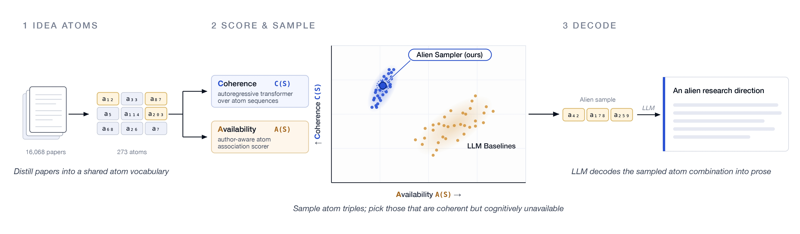

# The Alien Space of Science

Code and data for **The Alien Space of Science: Sampling Coherent but Cognitively Unavailable Research Directions**.

Alien represents papers as idea atoms and ranks combinations using a coherence transformer and an author–atom dual encoder. An LLM can then turn selected combinations into research proposals.

<p align="center"></p>

## 1. Install

Use Python 3.11 or newer. Run commands from this repository's root.

```bash
python3 -m venv .venv
source .venv/bin/activate
pip install -r requirements.txt
```

Inference works on CPU or CUDA. Retraining the full datasets requires substantial GPU compute; the availability model was trained on four A100 GPUs. LLM keys are only needed for reconstruction and atomization.

## 2. Download the artifacts

The [Alien Space of Science collection](https://huggingface.co/collections/alejandrohdez/alien-space-of-science-6ad8b17d0399975c463c6e1e) is the release landing page.

Download the camera-ready bundles from the public [model repository](https://huggingface.co/alejandrohdez/alien-models) and [data repository](https://huggingface.co/datasets/alejandrohdez/alien-data).

```bash
MODEL_REPO="alejandrohdez/alien-models"
DATA_REPO="alejandrohdez/alien-data"
hf download "$MODEL_REPO" --include "*_model/*" --local-dir models
hf download "$DATA_REPO" papers.tar.gz data.tar.gz --repo-type dataset --local-dir downloads
tar -xzf downloads/papers.tar.gz
tar -xzf downloads/data.tar.gz
```

This provides `papers/clusters_80.json`, all 16,068 papers' methodological summaries and atom files, `data/llm-papers.db`, the coherence training data, and both model directories. See [DATA.md](DATA.md) for contents and optional downloads.

Fixed atom combinations and proposal texts from Alien, Random, Claude, and Gemini are available separately:

```bash
hf download "$DATA_REPO" research-assets.tar.gz --repo-type dataset --local-dir downloads
tar -xzf downloads/research-assets.tar.gz
```

## 3. Sample atom combinations

```bash
python alien.py sample --top-k 20 --output-dir results/demo
```

The default draws 1,000 candidate sequences, keeps distinct triplets, scores them with both models, and selects the best combinations at β = 0.7. It produces `results/demo/k3/beta_0.7/results.json`. Sampling makes no LLM calls. The selected count is capped by the number of distinct candidates.

Change the tradeoff or candidate count:

```bash
python alien.py sample --n-gen 10000 --betas 0.4 0.7 --top-k 300 --output-dir results/sweep
```

Higher β favors less available combinations. The score is `(1 − β) × z(coherence) + β × z(unavailability)`, where unavailability is negative availability. Normalization uses the entire candidate pool before selecting results. JSON includes atom IDs, component scores, and rankings.

The paper's exhaustive candidate pool is more expensive; use a GPU:

```bash
python alien.py sample --ks 3 --exhaustive-ks 3 --betas 0.7 --top-k 300 \
  --device cuda --output-dir results/exhaustive
```

Different candidate pools and numerical backends can change rankings.

## 4. Reconstruct proposals

Reconstruction uses LiteLLM. Set the key for your chosen provider, for example `GEMINI_API_KEY` or `ANTHROPIC_API_KEY`, then run:

```bash
python alien.py reconstruct --method inference \
  --results results/demo/k3/beta_0.7/results.json --top-k 3 \
  --reconstruction-model gemini/gemini-3.1-pro-preview
```

This makes paid API calls and writes Markdown under `reconstructions/inference/`. Rerunning resumes completed proposals. Decoder, prompt, and atom-catalogue changes use separate output/cache directories. Use `--cache-dir reconstructions/cache` to reuse proposals across selections.

## 5. Retrain and use your checkpoints

Coherence data is included in `data.tar.gz`. These options match the released coherence model's training settings:

```bash
python alien.py train-coherence \
  --train data/coherence_dataset/coherence_train.jsonl \
  --val data/coherence_dataset/coherence_val.jsonl \
  --token-mapping data/coherence_dataset/token_mapping.json \
  --output-dir models/coherence_model_retrained \
  --epochs 30 --batch-size 64 --gradient-accumulation-steps 2 \
  --learning-rate 0.0001 --warmup-steps 1000 --max-seq-len 32
```

Download the compact availability dataset (about 1.8 GB compressed, 4.3 GB extracted):

```bash
hf download "$DATA_REPO" availability-compact.tar.gz --repo-type dataset --local-dir downloads
tar -xzf downloads/availability-compact.tar.gz
python alien.py train-availability --dataset data/availability_dataset \
  --output-dir models/availability_model_retrained --batch-size 4096 --epochs 100
```

Training exports the model with its matching author bank. Reduce `--batch-size` for a smaller GPU. For four GPUs, use `torchrun --standalone --nproc_per_node=4 -m generation.train_availability --compile` with the same arguments. `--resume` continues an interrupted run from its last completed epoch.

```bash
python alien.py sample \
  --coherence-model models/coherence_model_retrained \
  --availability-model models/availability_model_retrained \
  --top-k 20 --output-dir results/retrained
```

## Atomization and rebuilding data

The original atomization, clustering, and dataset-building tools are included. See [ADVANCED.md](ADVANCED.md) for their commands and API-key requirements. Prompts and source code are intended to be adapted to your corpus.

Run `python alien.py --help` or `python alien.py <command> --help` for options.
